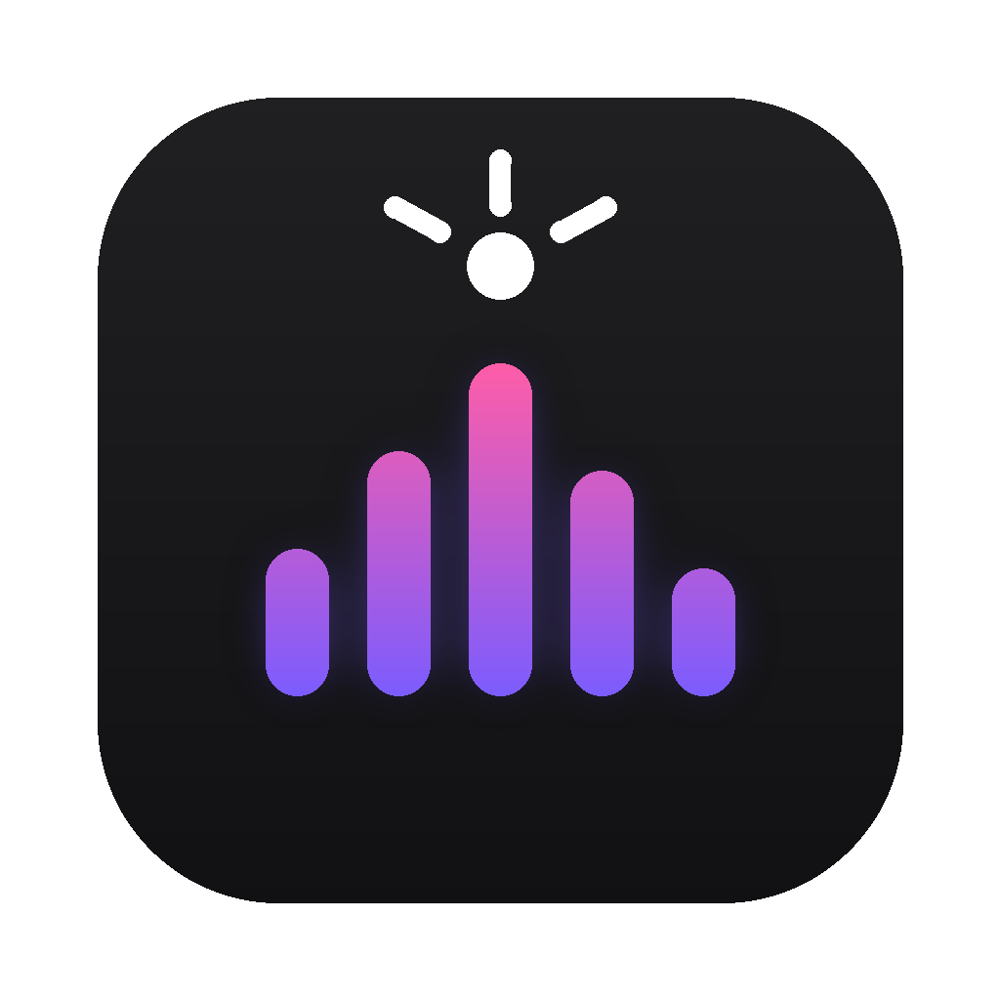

<p align="center"></p>

# Snaptune

**손짓 한 번(snap)으로, 지금 상황에 맞는 음악(tune)을.**
맥북 노치에 붙어서 지금 듣는 곡을 보여 주고, 손짓 · 상황 · 취향을 보고 알아서 음악을 틀어 주는 앱이에요.
Spotify · Apple Music · YouTube (Music) · 멜론에서 돼요.

- **노치 위젯**: 평소엔 노치 양옆에 작은 알약(앨범커버 · 이퀄라이저 · 가사 한 줄). 마우스를 올리면 펼쳐져 카메라 화면, 가사, 재생 버튼, 좋아요.
- **손짓으로 장르**: 맥북 카메라나 라즈베리파이 카메라로 손짓을 인식 → 그 장르 플레이리스트 (제목으로 진짜 그 장르인지 걸러서). 스와이프로 곡 넘기기 · 볼륨.
- **알아서 틀기 (상황 엔진)**: 요일 · 시간 · 날씨 · 워치 활동을 보고 장르를 골라요. 틀 때마다 얼마나 들었는지 · 좋아요 · 금방 바꿨는지를 기록해서 배우고(맥락 밴딧), 분석 창에서 잘 맞히는지 볼 수 있어요.
- **알아서 단골 · 부드러운 전환 · 같은 장르 다른 플리 · 내 플레이리스트**
- **하드웨어 (선택)**: 라즈베리파이 + 웹캠 + OLED 3개 + 3D 프린트 케이스 (`pi/`, `case/`)

## ⬇️ 다운로드 (macOS · 애플 실리콘)

**가장 쉬운 방법 — 터미널에 한 줄** (경고창 없이 바로 열려요)

```bash
curl -fsSL https://github.com/2612-oss/pg/releases/latest/download/install.sh | bash
```

**또는 dmg 로** — [Snaptune.dmg 받기](https://github.com/2612-oss/pg/releases/latest/download/Snaptune.dmg)

1. `Snaptune.dmg` 를 열고 **Snaptune** 을 **Applications** 폴더로 끌어다 놓기
2. Snaptune 을 열면 **"Snaptune"이(가) 열리지 않음** 이 떠요 → **완료** 누르기
   (애플 공증을 안 받은 앱이라 맥이 한 번 막아요. 우클릭 → 열기로는 안 넘어가요)
3. **시스템 설정 → 개인정보 보호 및 보안** → 맨 아래 *"Snaptune"이(가) 차단되었습니다* 옆 **그래도 열기** → 암호 입력 → **그래도 열기**
   (2번을 하고 1시간 안에 해야 버튼이 보여요)
4. 노치에 마우스를 올려 **Spotify 로그인**

그래도 안 열리면 터미널에: `xattr -dr com.apple.quarantine /Applications/Snaptune.app`

> Snaptune 은 Spotify 와 관계없는 개인 프로젝트예요. Spotify 는 Spotify AB 의 상표이고, 이 앱은 공개된 Spotify Web API 를 써요.
> (예전 이름: Spotify Notch. 예전 앱의 로그인 · 설정 · 기록은 처음 켤 때 자동으로 옮겨 와요.)

## 실행

**앱으로 (평소)**: Launchpad 나 Spotlight 에서 **Snaptune** 을 켜요. 끄기는 노치 우클릭 → 종료.
노치 우클릭 메뉴에서 **로그인할 때 자동 실행**, **라즈베리파이 인식 켜기/끄기**도 할 수 있어요.
코드를 고쳤으면 `npm run app` 으로 앱을 다시 만들어요 (응용 프로그램 폴더에 덮어쓰고 다시 켬).
다른 사람에게 줄 설치 파일은 `npm run dist`, 깃허브 Releases 에 올리기는 `npm run release` (처음 한 번 `brew install gh` · `gh auth login`) → `dist/Snaptune.dmg` (내 라즈베리파이·맥 주소는 빼고, `설치 안내.txt` 를 같이 넣어요).

앱 안의 `config.json` 은 고치기 어려워서, 바꾸고 싶은 값만
`~/Library/Application Support/snaptune/config.json` 에 적으면 덮어써요. 예) `{ "pi": "ubuntu@192.168.0.10", "piStream": "http://192.168.0.10:8090/stream" }`
내 라즈베리파이 주소처럼 나만 쓰는 값은 여기에 두면 깃허브에 안 올라가요. 파이 쪽은 `pi/config.local.json` (예: `{ "mac": "http://맥IP:8899" }`).

**개발할 때**:

```bash
npm install   # 처음 한 번 (node_modules 가 이미 있으면 생략)
npm start
```

처음 실행하면 노치가 펼쳐지면서 **Spotify 로그인** 버튼이 보여요. 누르고 브라우저에서 허용하면 끝.
(`spotify-widget` 과는 로그인 정보를 따로 저장해서, 이 앱에서 한 번 더 로그인해야 해요.)

## 카메라 (제스처 인식)

노치 우클릭 → **카메라**, 또는 설정 화면의 "카메라"에서 골라요. 인식 코드는 둘 다 `pi/gesture_pi.py` (MediaPipe + scikit-learn).

| 카메라 | 어디서 도는지 | 영상 주소 |
|---|---|---|
| 라즈베리파이 웹캠 | 라즈베리파이 (`gesture-pi` 서비스) | `config.json` 의 `piStream` |
| 맥북 카메라 | 이 맥 (앱이 직접 켜고 끔) | `http://127.0.0.1:8091/stream` |

- 맥북 카메라를 처음 고르면 `pi/setup-mac.sh` 가 한 번 설치해요 (1~3분). 파이썬 환경·모델·녹화한 샘플은
  `~/Library/Application Support/snaptune/gesture/` 에 있어요. 안 될 땐 그 폴더의 `camera.log`, `setup.log`.
- 동작 학습은 카메라마다 따로예요. 설정 화면 "제스처 학습"에서 다시 녹화하거나 **라즈베리파이 샘플 가져오기**.
- 맥북 카메라를 쓰는 동안엔 라즈베리파이가 보내는 제스처는 무시해요 (둘이 동시에 조작하지 않게).
- OLED 연결은 `banner/oled-wiring.png` 도면 참고.

### OLED 화면 · 팬 (라즈베리파이)

- **OLED** 화면은 곡 / 시계 / 가사 3가지예요. 가사가 없는 곡이면 가사 자리에 상태(CPU 온도·팬·인식 속도·사람 보임)가 나와요.
  - **2~3개** 꽂으면 하나에 한 화면씩 고정 (1번 곡 = I2C 1, 2번 시계 = I2C 3, 3번 가사 = I2C 5). 연결은 `banner/oled3-wiring.png` 도면.
  - **1개** 면 그 화면이 3장을 8초마다 넘겨요. 동작을 유지하는 중이거나 제스처를 방금 보냈으면 곡 화면에 머물러요.
  - 맥 설정 → **OLED 화면** 에서 각 화면에 지금 나오는 그림을 볼 수 있어요. **화면 번호 띄우기** 를 누르면 각 OLED 에 1·2·3 이 5초 나와요.
  - 바꾸기: 파이 `config.json` 의 `"oled_screens": [{"bus": 1, "page": "song"}, …]`, `"oled_page_seconds": 8`.
- **팬** 은 CPU 가 65°C 이상이면 켜고 55°C 이하면 꺼요 (`pi/fan.py`). 연결은 `banner/fan-wiring.png` 도면.
  GPIO18(12번 핀) → 1kΩ 저항 → 트랜지스터 → 팬. 핀·온도는 `config.json` 의 `"fan_pin"`, `"fan_on"`, `"fan_off"`.

### 자동 기능 (설정 → 자동)

| 기능 | 하는 일 | 기본 |
|---|---|---|
| 인식 소리 | 제스처가 인식되면 짧은 소리 + 노치 알약이 반짝 (초록 = 실행, 노랑 = 이미 그 장르라 무시) | 켜짐 |
| 자리 비움 감지 | 카메라에 사람이 N분 안 보이면 멈추고, 돌아오면 이어서 재생 | 꺼짐 |
| 시간대별 장르 | 정한 시각이 되면 그 장르로 바꿈 (음악이 나오고 있을 때만) | 꺼짐 |
| 부드러운 전환 | 장르를 바꿀 때 1초 동안 소리를 줄였다가 새 플리를 틀고 1.5초 동안 원래 크기로 (Spotify, 볼륨을 바꿀 수 있는 기기만) | 켜짐 |
| 알아서 단골 만들기 | 검색으로 튼 플리를 10분 넘게 들으면 ★ 단골, 45초 안에 바꾸거나 2분 안에 3곡 넘기면 "별로". 다음엔 단골이 자주 나오고(검색에 안 떠도), 별로 2번이면 안 나옴. 기록은 `favorites.json` (userData), 설정에서 하나씩 지울 수 있음 | 켜짐 |

장르마다 검색어 대신 **내 Spotify 플레이리스트**(또는 좋아요 표시한 곡)를 고를 수도 있어요. 그땐 매번 무작위 곡부터 틀어요.

### 상황 엔진 · 알아서 틀기

장르를 고르지 않아도 **지금 상황**에 맞는 장르를 골라 틀어요. 재생 조작에서 동작을 "알아서 틀기"로 고르거나, 우클릭 메뉴, `POST /auto` 로 써요.

- 상황 = 요일(평일·주말) · 시간대(새벽·아침·낮·오후·저녁·밤) · 날씨(설정에 도시를 적으면, Open-Meteo) · 활동(워치가 보내면)
- **보상 기록**: 틀 때마다 `history.jsonl` (userData) 에 한 줄 — 상황 · 장르 · 어떻게 틀었나 · 고를 확률 · 들은 시간 · 좋아요 · 볼륨 · 넘김 · 보상
  - 보상 = 들은 비율(10분 = 1) + 좋아요 1 + 볼륨 올림 0.2 − 45초 안에 직접 바꿈 1 − 0.5 × (넘긴 곡 / 3)
- **고르기 (맥락 밴딧, Thompson sampling)**: 장르마다 "상황 특징 17개 → 보상"을 베이즈 선형 회귀로 배우고,
  고를 때마다 그럴듯한 값을 하나씩 뽑아 1등을 틀어요. 기록이 적은 장르는 불확실한 만큼 가끔 뽑혀서 새로 알아가요.
  장르 이름·검색어가 상황에 어울리면 · 시간대별 장르 칸이면 기본 점수가 조금 붙어요. 오래된 기록은 90일마다 무게 절반.
- 예전 `situations.json` 이 있으면 처음 켤 때 기록으로 옮기고 `situations.old.json` 으로 바꿔 둬요
- **분석 창** (우클릭 → 분석…, 또는 설정 → 분석 열기): 알아서 틀기 vs 직접 고름 지표(금방 바꾼 비율 · 이어 들은 시간 · 평균 보상),
  날짜별 그래프, 지금 상황의 장르별 예상 보상, 장르별 · 상황×장르 표, 최근 기록. 기록 지우기도 여기서
- 워치용: `POST /context {"activity":"still|walking|running","heart":72}` → 5분 동안 상황에 들어가요

코드는 `main.js` 의 "자동 기능" 묶음. 사람이 보이는지는 인식 프로그램이 `/now?present=1` 로 1초마다 알려줘요 (`pi/sender.py`).

### 스와이프

좌우·위아래로 쓸기는 학습 없이 돼요. 판정 숫자는 `pi/swipe.py` 맨 위 (`HANDS` 거리, `SPEED` 빠르기, `STRAIGHT` 곧은 정도).

### 인식을 더 정확하게

코드가 알아서 하는 것 (`pi/classifier.py` 머리말에 자세히):
손 모양 숫자를 더 계산해서 학습, 샘플을 조금씩 흔든 복사본으로 같이 학습, 녹화한 샘플과 안 닮은 자세는 "모름"으로 버리기.

직접 해 주면 좋은 것 (효과 큰 순서):

1. **평소 모습을 녹화하기** — 설정의 [평소 모습 녹화]. 턱 괴기, 머리 만지기, 폰 보기처럼 평소 손 모양을 섞어서 2~3번.
2. **같은 동작을 여러 번 녹화하기** — 자리·거리·손 각도를 조금씩 바꿔서 2~3번. 한 번만 녹화하면 그 자리에서만 잘 알아봐요.
3. **서로 다른 동작으로 정하기** — 학습 결과에 "서로 닮은 동작: A↔B"가 뜨면 둘 중 하나를 더 다르게.
4. **카메라 환경** — 밝은 곳, 카메라에서 1~1.5m, 손이 화면 안에 다 보이게.
5. **라즈베리파이 식히기** — 방열판이나 팬. 뜨거우면(80°C 근처) 느려져서 인식이 덜 자주 돌아요.

## 음악 플랫폼

노치 우클릭 → **음악 플랫폼**, 또는 설정 화면 맨 위에서 골라요. 코드는 `players/` 폴더에 플랫폼마다 한 파일.

| 플랫폼 | 곡 정보·가사 | 재생 조작 | 좋아요 | 장르 제스처 |
|---|---|---|---|---|
| Spotify (`main.js`) | O | O (Premium) | O | Spotify 플레이리스트 검색 |
| Apple Music (`players/apple.js`) | O | O | O | 내 보관함에서 → 없으면 유튜브 |
| YouTube Music (`players/youtube.js`) | O | O | 로그인하면 | 프리미엄 로그인 필요 → 안 했으면 유튜브 |
| YouTube (`players/youtube.js`) | O | O | 로그인하면 | 유튜브 플레이리스트 검색 (광고 나올 수 있음) |
| 멜론 (`players/melon.js`) | X | 재생/이전/다음/맥 볼륨 | X | 유튜브로 대신 |

- 유튜브는 앱 안의 숨은 창에서 틀어요. 우클릭 → **YouTube 창 보기**로 꺼내서 로그인하거나 직접 고를 수 있어요.
- Apple Music 은 처음에 맥이 "음악 앱을 제어해도 될까요?" 하고 물어봐요. 멜론은 손쉬운 사용 권한이 필요해요.
- 새 플랫폼 추가: `players/` 에 `now()` / `control()` / `playGenre()` 가 있는 파일을 만들고 `main.js` 의 `PLATFORMS`, `players` 에 한 줄씩.

## Spotify 앱 설정 (Client ID)

`config.json` 에 Client ID 가 이미 들어 있어요. 새로 만들려면:

1. https://developer.spotify.com/dashboard → **Create app**
2. Redirect URI: `http://127.0.0.1:8888/callback`
3. API: **Web API**
4. Client ID 를 `config.json` 에 넣기

```json
{ "clientId": "여기에_Client_ID", "notchWidth": 190 }
```

`notchWidth` 는 선택이에요. 알약이 노치보다 좁거나 넓어 보이면 숫자를 바꿔 맞추세요.

---

## 코드 구조 (직접 고쳐보고 싶을 때)

```
snaptune/
├── main.js      앱의 뒤편: 로그인, Spotify 에 1.5초마다 물어보기, 가사/색 구하기, 노치 창 만들기
├── preload.js   화면과 main.js 사이 다리 (주고받을 수 있는 메시지 이름 목록)
├── notch.html   화면: 생김새(CSS) + 동작(JS)
├── settings.html        설정 화면: 제스처마다 장르/재생 조작 정하기 (우클릭 → 설정…)
├── settings-preload.js  설정 화면과 main.js 사이 다리
├── camera.js    웹캠 켜기/끄기, 프레임을 제스처 엔진에 넘김
├── gestures.js  제스처 엔진: 인식기 등록 + 오작동 방지(다수결, 유지 시간)
├── recognizers/
│   └── motion-swipe.js  인식기 예시 (움직임으로 스와이프, 기본은 꺼짐)
├── config.json  Spotify Client ID, 노치 너비, 카메라/인식기 설정
└── package.json 실행 설정 (Electron)
```

### 데이터가 흐르는 길

```
Spotify 서버 ──(1.5초마다)──▶ main.js poll()
                                 │  곡 정보 + 대표 색 + 좋아요 여부
                                 ▼
                         broadcast('track', 곡)
                                 │  (preload.js 통로)
                                 ▼
                       notch.html  api.on('track', render)
                                 │
                       매 프레임 tick(): LP 회전, 진행바, 가사 줄 고르기, 접기 판단

버튼 클릭 ─▶ notch.html  api.send('control', 'next')
                                 ▼
                       main.js  control('next') ─▶ Spotify 서버
```

### 웹캠 · 제스처

```
웹캠 ─▶ camera.js (1초에 15번, 160x120 거울 프레임)
          ▼
        gestures.js  Gesture.feed(frame)
          │  등록된 인식기들이 '제스처 이름' 또는 null 을 돌려줌
          │  hold 가 있는 제스처는 다수결 70% + 유지 시간을 넘어야 확정
          ▼
        api.send('gesture', 'swipe_right')
          ▼
        main.js handleGesture()  ◀── HTTP POST /gesture (파이썬, 라즈베리파이)
          │  쿨다운 1.2초 → 설정(settings.json)에서 이 제스처의 동작 찾기
          ▼
        control('next') ─▶ Spotify      broadcast('gesture') ─▶ 화면에 "다음 곡" 표시
```

**제스처 → 장르 / 조작**: 노치 우클릭 → **설정…** 에서 정해요 (저장 위치: userData 의 `settings.json`).
처음 값은 `main.js` 의 `DEFAULT_GENRES`, `DEFAULT_CONTROLS`.

장르 — 제스처를 하면 검색어로 Spotify 플레이리스트를 찾아서 하나를 틀어요 (기획서 1·3번).
검색어 + 같은 장르의 다른 말(예: 힙합 → `hip hop` · `힙합` · `rap`)로 후보를 40개쯤 모으고, **제목·설명에 그 장르 낱말이 있는지** 점수를 매겨
기준(`FIT_PASS`)을 넘는 플리만 틀어요. 다른 장르가 섞인 제목("외힙, 팝송")·곡이 15개 미만인 플리는 깎이고, "힙한"처럼 헷갈리는 낱말은 안 쳐요.
장르 낱말 사전은 `main.js` 의 `GENRE_WORDS` (Spotify 개발 모드 앱은 플리 안의 곡·가수 장르를 볼 수 없어서 제목으로 판단해요).
**같은 장르 다른 플리**: 재생 조작에서 동작을 "같은 장르 다른 플리"로 고르거나 우클릭 → "○○ 다른 플리로". 장르는 그대로 두고 방금 튼 플리만 빼고 다시 골라요.
금방 넘긴 플리는 "별로"로 배우지만, 상황 엔진엔 그 장르를 탓하지 않아요.
최근에 튼 5개는 빼고 고르니까 같은 제스처를 해도 매번 다른 플리가 나와요. 지금 장르는 노치 머리줄에 표시돼요.

| 장르 | 제스처 이름 | 검색어 |
|---|---|---|
| 락 | `rock` | rock |
| 팝 | `pop` | pop hits |
| 힙합 | `hiphop` | hip hop |
| 재즈 | `jazz` | jazz |

재생 조작 (기획서 2번)

| 제스처 이름 | 동작 |
|---|---|
| `swipe_left` / `swipe_right` | 이전 곡 / 다음 곡 |
| `swipe_up` / `swipe_down` | 볼륨 + / − (10씩) |
| `play_pause` | 재생 / 일시정지 |
| `like` | 좋아요 |

제스처 이름은 라즈베리파이 대시보드(`http://파이IP:8090/`)에서 MediaPipe + scikit-learn 으로 녹화·학습한 동작 이름이에요.
`swipe_*` 는 학습 없이 손바닥 이동으로 알아채요. 자세한 건 `pi/README.md`.

**인식기 추가하기** (예: MediaPipe 손 모양)

1. `recognizers/hand-pose.js` 를 만들고 `function createHandPose() { return (frame) => '제스처이름' 또는 null }`
   (`gestures.js` 맨 위에 MediaPipe 뼈대 주석이 있어요)
2. `notch.html` 의 `<script src="recognizers/motion-swipe.js">` 아래에 한 줄 추가
3. `notch.html` 9번 섹션 `RECOGNIZERS` 에 `handPose: () => Gesture.add('hand-pose', createHandPose(), { hold: 1200 })`
4. `config.json` 에 `"recognizers": { "handPose": true }`
5. 새 제스처 이름이면 우클릭 → 설정… 에서 **+ 장르 추가** 또는 **+ 조작 추가**

**카메라 없이 시험하기**

- 우클릭 → 제스처 테스트
- 터미널: `curl -X POST http://127.0.0.1:8899/gesture -d '{"name":"swipe_right"}'`
- 지금 곡 정보(OLED 표시용): `curl http://127.0.0.1:8899/now` → `{ title, artist, isPlaying, genre }`

**라즈베리파이에서 보내기**: `config.json` 에 `"gestureServer": { "host": "0.0.0.0", "port": 8899 }` 를 넣고
파이에서 `requests.post('http://<맥 IP>:8899/gesture', json={'name': 'swipe_right'})`.
같은 와이파이의 누구나 보낼 수 있게 되니 믿을 수 있는 망에서만 쓰세요.

**config.json 옵션**

```json
{
  "clientId": "...",
  "recognizers": { "motionSwipe": true },
  "gestureServer": { "host": "127.0.0.1", "port": 8899 }
}
```

카메라는 기본으로 꺼져 있어요. 웹캠을 연결하면 설정에서 켜세요. `gestureServer` 를 `false` 로 하면 HTTP 서버를 끄고요.
macOS 카메라 권한은 처음 한 번 물어봐요. 거절했다면 **시스템 설정 → 개인정보 보호 및 보안 → 카메라** 에서 실행한 터미널을 켜세요.

### 어디부터 읽을까

1. **notch.html 맨 아래 "8. 메인과 연결"** — 화면이 어떤 메시지를 받아서 뭘 하는지 한눈에 보여요.
2. **main.js 맨 아래 "시작"** — 앱이 켜질 때 하는 일.
3. **main.js "재생 정보 폴링"** — 곡 정보를 가져오는 핵심.
4. 그다음 궁금한 기능 섹션으로. 섹션마다 위에 설명 주석이 있어요.

### 직접 바꿔보기 좋은 곳

| 바꾸고 싶은 것 | 위치 |
|---|---|
| 곡 바뀔 때 펼쳐져 있는 시간 | `notch.html` 의 `api.on('peek', () => peekFor(4500))` |
| 마우스가 떠난 뒤 접히기까지 시간 | `notch.html` 의 `updateNotch()` 안 `450` |
| 알약 앨범커버 회전 속도 | `notch.html` 의 `RPM_DEG` |
| 제스처 쿨다운 | `main.js` 의 `GESTURE_COOLDOWN_MS` |
| 볼륨 한 번에 바뀌는 양 | `main.js` 의 `VOLUME_STEP` |
| 다수결 기준 | `gestures.js` 의 `MAJORITY` |
| 스와이프 예민함 | `recognizers/motion-swipe.js` 맨 위 숫자들 |
| 펼친 카드 크기 | `notch.html` 의 `--card-w`, `--card-h` + `main.js` 의 `NOTCH_PANEL_W`, `NOTCH_CARD_H` (둘 다 같이) |
| 알약 양옆 폭 | `notch.html` 의 `--pill-side` |
| 노치 아래 가사 줄 높이 | `notch.html` 의 `--strip-h` |
| Spotify 에 물어보는 간격 | `main.js` 의 `POLL_MS` |

### 알아두면 좋은 것

- **클릭 통과**: 접혀 있을 땐 `main.js` 가 `setIgnoreMouseEvents(true, { forward: true })` 로 클릭을 뒤로 넘겨요.
  `forward: true` 덕분에 마우스 *움직임*은 여전히 화면에 들어와서, 알약 위에 왔는지 `notch.html` 이 계산하고
  `api.send('interactive', true)` 로 클릭을 다시 받게 해요.
- **펼치기 애니메이션**: 창 크기는 그대로고 `.card` 의 `clip-path` 만 바꿔요. 창 크기를 바꾸는 것보다 훨씬 부드러워요.
- **재생 위치 보간**: Spotify 정보는 1.5초마다 오지만, 진행바와 가사는 `position()` 이 "받은 위치 + 흐른 시간"을 계산해서 매 프레임 부드럽게 움직여요.
- 재생 조작과 좋아요는 Spotify **Premium** 계정에서만 돼요.
- Spotify 개발 모드 앱은 대시보드의 **User Management** 에 등록한 계정만 쓸 수 있어요(앱을 만든 본인은 바로 가능).
